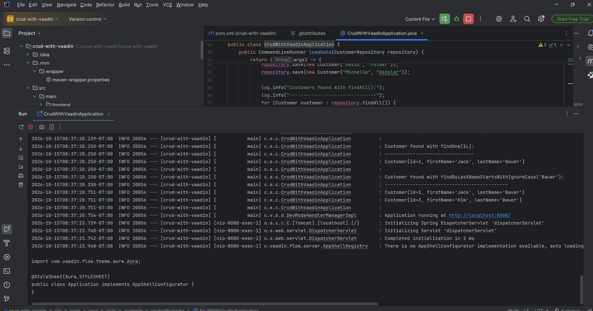
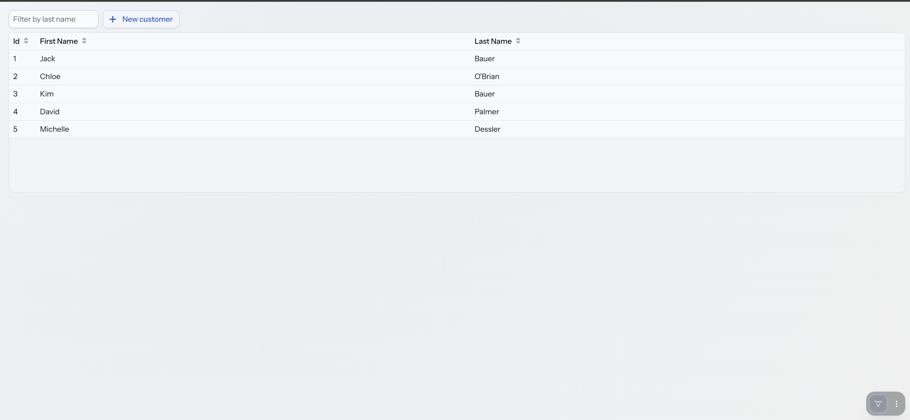
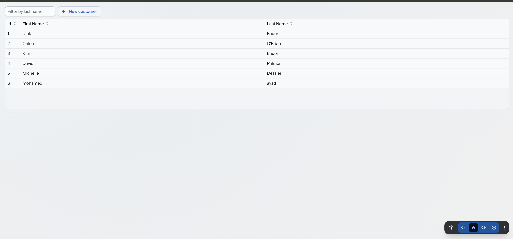
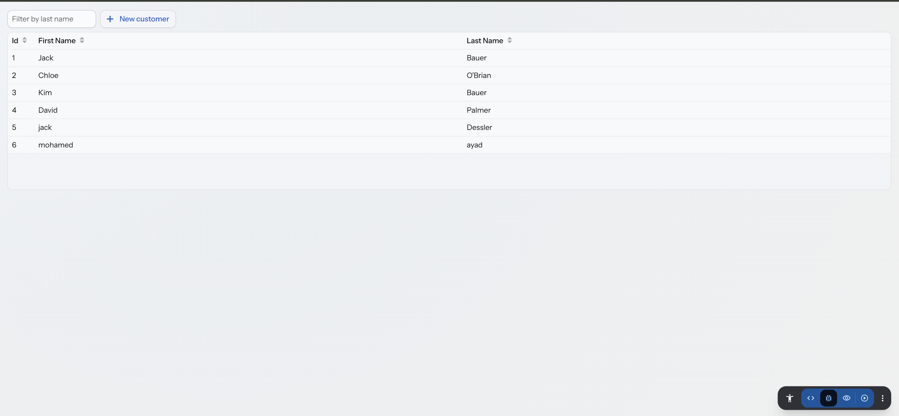
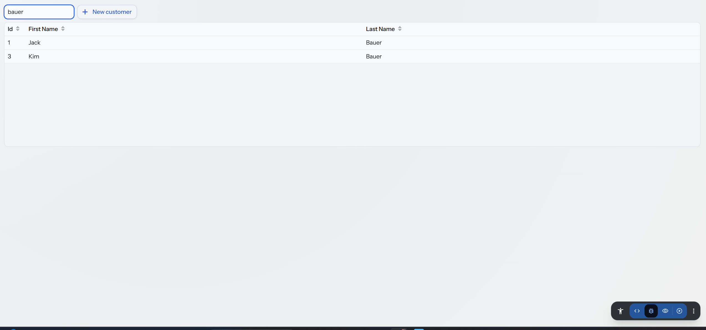
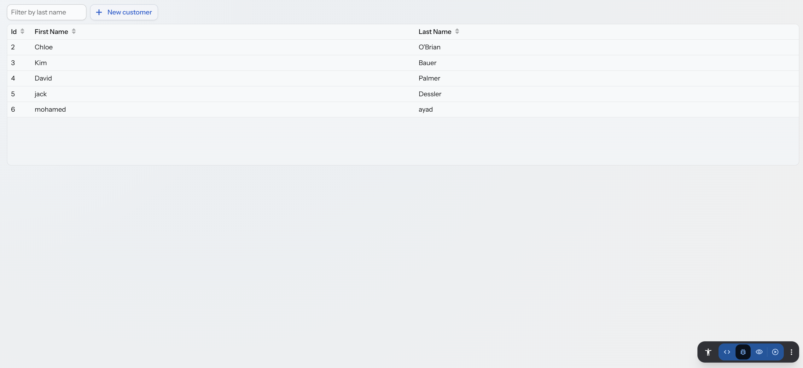

# CRUD with Vaadin

A simple **CRUD** (Create, Read, Update, Delete) web application for managing customers, built with **Java**, **Spring Boot** and **Vaadin**.

The project follows the official Spring guide [Creating CRUD UI with Vaadin](https://spring.io/guides/gs/crud-with-vaadin/) and was created as a practical assignment to practise Java, Git, GitHub and collaboration.

**Author:** Mohamed Ayad (Student ID: 73180)

---

## Features

- **Create** – add a new customer with the *New customer* button
- **Read** – list all customers in a table (grid)
- **Update** – click a customer, edit the first or last name and press *Save*
- **Delete** – click a customer and press *Delete*
- **Filter** – search customers by last name (case-insensitive)

Five sample customers are added automatically when the application starts.

## Technologies

| Technology | Version | Purpose |
|---|---|---|
| Java | 21 | Programming language |
| Spring Boot | 4.1.1 | Application framework |
| Spring Data JPA | (Spring Boot managed) | Saving and reading data from the database |
| H2 Database | (Spring Boot managed) | In-memory database |
| Vaadin | 25.3.2 | Web user interface written in Java |
| Maven | Wrapper included | Build tool |

## Project structure

```
src/main/java/com/example/crudwithvaadin/
├── CrudWithVaadinApplication.java   # Starts the app and loads 5 sample customers
├── Customer.java                    # JPA entity: id, firstName, lastName
├── CustomerRepository.java          # Spring Data repository (CRUD + filter by last name)
├── MainView.java                    # Main page: grid, filter field, "New customer" button
└── CustomerEditor.java              # Form with Save, Cancel and Delete buttons
doc/                                 # Screenshots of the application running locally
```

## How to run

**Requirements:** JDK 21 or newer.

**Option 1 – IntelliJ IDEA**
1. Open the project folder (the one with `pom.xml`).
2. Wait until Maven downloads the dependencies.
3. Run `CrudWithVaadinApplication`.
4. Open http://localhost:8080 in the browser.

**Option 2 – command line**
```bash
# Windows
mvnw.cmd spring-boot:run

# Linux / macOS
./mvnw spring-boot:run
```
Then open http://localhost:8080.

The first start takes a few minutes because Vaadin downloads its frontend tools.

## Screenshots

### Application startup log


### Application running


### Create a customer


### Update a customer


### Filter by last name


### Delete a customer


## Contributors

- Mohamed Ayad – author
- Assil – reviewed the project and improved the documentation
